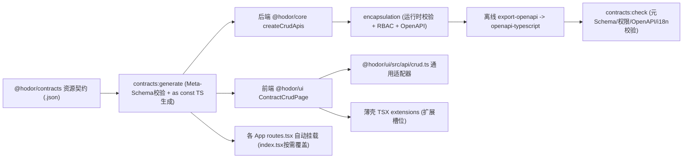

# 全栈 JSON 契约驱动 CRUD 引擎与根级统一 Monorepo 详细设计

> 编写日期：2026-11-20
> 关联计划变更：[1120-全栈JSON契约CRUD与Monorepo架构(优化)计划变更.md](./1120-全栈JSON契约CRUD与Monorepo架构(优化)计划变更.md)

## 1. 背景与痛点分析

### 1.1 现状问题
虽然系统前端已具备 `SchemaCrudPage` 底座（覆盖 37 个 CRUD 页面），后端具备 `encapsulation` + JSON Schema + OpenAPI 自动导出能力，但当前开发模式仍存在以下结构性痛点：

1. **同一批字段在全栈重复维护 3~4 遍**：
   - 后端 `model.ts` 定义 `PO`/`VO`/`Keys`；
   - 后端 `service.ts` 拼装 `listReq`/`listRes`/`addReq`/`updateReq`/`getReq`；
   - 前端 `platform/packages/ui/src/api/` 手写接口封装与类型；
   - 前端页面目录手写 `index.tsx` + `TheFilter.tsx` + `TheTable.tsx` + `TheForm.tsx` + `cardFields`。
   - 从近半年新增模块提交统计（如 `webhook_config`、`api-token`）可见，单个标准 CRUD 往往需要修改 **32~36 个文件**。
2. **双独立 pnpm Workspace 割裂**：
   - `server/` 与 `platform/` 各自拥有独立 `pnpm-workspace.yaml` 和 `pnpm-lock.yaml`，无法在顶层通过 `workspace:*` 共享包。
   - 且存在 3 组包名冲突：`server/packages/{admin,enterprise,personal}` 与 `platform/apps/{admin,enterprise,personal}` 均名为 `@hodor/{admin,enterprise,personal}`。
3. **前端 `DynamicForm` 过于简陋、Schema 同步繁琐**：
   - 现有 `DynamicForm` 仅支持 4 种基础输入且无网格布局、联动、转换能力，导致绝大多数页面被迫手写 `renderForm` 或另起独立 Dialog；
   - 依赖启动后端 8787 服务拉取 `/doc.json` 生成 `openapi.d.ts` 及运行 `sync:schemas` 刷新 D1，开发链路长且容易遗漏。
4. **近一年 Git 提交抽样（2025-09 ~ 2026-08 共 1,100 次，近半年 616 次）高频重复痛点**：
   - 国际化文案补漏与漂移：**110 次 (17.9%)**
   - CRUD 四件套手写 JSX：**89 次 (14.4%)**
   - `openapi.d.ts` 手动同步 & 手写 `ui/src/api/*.ts`：**74 次 (12.0%) / 45 次 (7.3%)**
   - 后端 `model.ts` / `service.ts` CRUD 样板：**72 次 (11.7%)**
   - 权限 / 菜单 / `business.ts` / `constant.ts` 多点手工联动：**66 次 (10.7%) + 21 次**
   - `sync:schemas` D1 同步维护：**18 次 (2.9%)**

### 1.2 已确定的核心设计决策

1. **纯 JSON 配置文件 + 代码侧扩展槽位**：标准 CRUD 仅靠一份 `.json`（天然兼容未来服务端动态下发）驱动；复杂页面通过可选的薄 TSX 扩展注册槽位兜底。
2. **字段驱动（Field-Centric 单一事实源）**：每个字段在顶层 `fields` 定义一次（类型、约束、`ui` 展示/表单/筛选配置），由引擎自动投影到各视图，移动端卡片自动派生。
3. **约定推导 + 逐项覆盖 + 代码兜底**：只需声明 `resource`（如 `admin/rpa/config`），自动推导 API 基路径、权限命名空间与权限码、App 路由与校验 Schema，特殊项支持局部覆盖。
4. **根级统一 pnpm Monorepo + `@hodor/contracts` 顶层共享包**：将前端 3 个 App 重命名为 `@hodor/web-{admin,enterprise,personal}` 化解包名冲突，保留 `server` 和 `platform` 各自独立工具链成员隔离依赖差异，同步更新 CI 与 Docker 构建上下文。
5. **单文件合写契约**：同一份 `<resource>.json` 存放数据契约与 `ui` 分区，后端编译助手自动剥离 `ui`，不污染 OpenAPI 和服务端运行时。
6. **契约自动挂载路由 + `index.tsx` 按需覆盖**：`routes.tsx` 自动挂载纯 JSON 路由（0 TSX 文件）；若存在物理 `pages/.../index.tsx` 则自动优先使用它。
7. **V1 能力边界**：覆盖标准列表 CRUD、只读列表、声明式行动作、声明式详情弹窗、软删撤销、嵌入模式与后端 `createCrudApis`；树形 CRUD（`menu`、`department`）与强领域工作台保持现有实现或留待 V2。
8. **全量迁移全部 37 个现有 `SchemaCrudPage` 页面**，分批次有序推进并保持已有 E2E 与基建测试零回归。
9. **同步更新 `.agents/` 规范与 `docs/crud_developer_guide.md`**，并提供一键 `sync:all`（含离线 OpenAPI 导出与静态契约校验）。

---

## 2. 总体架构设计

### 2.1 根级统一 pnpm Monorepo 结构

- 根 `pnpm-workspace.yaml` 纳管 `packages/*`、`server`、`server/packages/*`、`server/apps/*`、`platform`、`platform/packages/*`、`platform/apps/*`。
- **为何保留 `server` 和 `platform` 本身作为 workspace 成员**：
  1. 两端使用不同版本的 ESLint、Prettier、`@types/node`（v22 vs v24），保留成员可使各自工具链安装于各自 `node_modules`，互不冲突；
  2. 仓库根 `tsconfig.json` 的 `typeRoots` 与前端 `e2e/fixtures/*/tsconfig.json` 依赖 `server/node_modules` 与 `platform/node_modules` 存在。
- **合并原生依赖构建白名单**：根 `pnpm-workspace.yaml` 合并 `@swc/core`、`better-sqlite3`、`bufferutil`、`esbuild`、`sharp`、`utf-8-validate`、`workerd` 7 个白名单并保留 `minimumReleaseAge: 0`。
- **防止 `tsgo` `rootDir` 漂移与 `FromSchema` 字面量展宽**：
  - `@hodor/contracts` 通过独立 `tsc` 构建输出 `./dist/*.js` 与 `./dist/*.d.ts`，并在 `package.json` `exports` 暴露；
  - `contracts:generate` 将全部 `.json` 转为 `as const satisfies CrudResourceContract` 的 TS 文件后再编译为 `.d.ts`，确保后端 `FromSchema` 获得精确字面量联合类型而非退化为 `unknown`。

### 2.2 共享契约协议（`@hodor/contracts`）

每份资源 JSON 契约遵循 `packages/contracts/schema/crud-resource.schema.json`（Draft 2020-12）：

- **资源元信息与约定推导 (`defaults.ts`)**：
  - `resource`: 例如 `"admin/rpa/config"` 或 `"enterprise/organization/attendance"`；
  - 自动推导 `app`（`admin`/`enterprise`/`personal`）、`route`、`api.basePath`（`/api/v1/{resource}`）、`permissionNamespace`（兼容 `enterprise` 去掉前缀规则如 `organization.attendance`，支持显式 `permissionNamespace` 覆盖）、`permissions`（支持设 `{}` 关闭按钮权限校验）。
- **字段定义 (`fields[]`)**：
  - 支持 `preset` 复用高频标准字段（`id`、`isEnabled`、`remark`、`createTimeUtc`、`updateTimeUtc`）；
  - `schema`: 标准 JSON Schema 2020-12 片段（可空字段显式声明 `type: ["...", "null"]`）；
  - `requiredOn`: `["add", "update", "list", "detail"]` 控制各接口必填矩阵；
  - `in`: `{ list, detail, add, update }` 控制字段参与哪些端点的请求/响应属性；
  - `ui`:
    - `labelKey`（或局部覆盖 `table.titleKey`/`form.labelKey`/`card.labelKey`）
    - `table`: `show`, `width`, `align`, `fixed`, `renderer` (`text`/`code`/`datetime`/`booleanChip`/`booleanText`/`booleanSwitch`/`enumChip`/`enumText`/`jsonArrayChips`/`jsonText`/`linkButton`/`stackedText`/`mediaStackedText`) 及对应展示属性
    - `card`: `role` (`title`/`subtitle`/`content`/`tag`/`hidden`)；未配置时引擎自动按字段类型派生
    - `filter`: `show`, `type` (`text`/`select`/`switch`), `defaultValue`, `options`, `transform` (`emptyToUndefined`/`trim`/`number`), `debounceMs`
    - `form`: `show`, `widget` (`text`/`email`/`number`/`textarea`/`password`/`code`/`switch`/`checkbox`/`select`/`multiSelect`/`treeFlatMultiSelect`/`tagInput`/`date`/`time`/`datetime`/`dynamicSubForm`/`divider`), `span`, `defaultValue`, `options`, `optionsSource`, `visibleWhen`, `disabledWhen`, `valueTransform`, `helperTextKey`, `placeholderKey`, `maxLength`, `showCharCount`, `toggleVisibility`, `rows`, `theme`, `validateJson`, `dynamicSubForm`
    - `detail`: `show`, `section`, `renderer`
- **页面行为、动作与软删**：
  - `api`: 可配置 `endpoints`（自定义 `list`/`add`/`update`/`delete`/`get`/`listAll`/`detail` 路径）、`loadDetailOnEdit`、`fixedParams`；
  - `actions`: 支持声明式 `apiAction`（单行 loading/disabled、`payloadMap`、确认提示、`truthyData`/`httpOk` 判定、Snackbar、可选刷新）与 `detail`（弹出声明式 `ContractDetailDialog`）；
  - `softDelete`: 声明 `resourceType`、`displayNameField`、`expectedUpdateTimeField`、`confirmMessageKey`、`deletePath`、`getPath`、`recycleBinPermissions`、`retryableErrorCodes`、`stateChangedErrorCodes`；
  - `filters`: 配置 `keyword`（支持任意字段名、`debounceMs`、`searchIcon`）、`defaultSort`、`sortableFields`、`showSortControls`、`fixed`；
  - `pagination` (`mode: 'offset' | 'cursor'`)、`refreshIntervalMs`、`embedded`、`cardMode`。

### 2.3 后端装配层 (`@hodor/core/middleware/encapsulation/crud.ts`)

- 升级 `common.schema.ts` 的 `listWrapper` / `listResponseWrapper` 为强泛型签名，彻底消除 `FromSchema<typeof listRes>` 退化为 `Record<string, unknown>` 并强转 `as unknown as` 的历史问题。
- 提供 `createCrudApis(contract, handlers)`：
  - 使用 `compileBackendSchemas(contract)` 自动生成 `listApi`、`listAllApi`、`getApi`、`addApi`、`updateApi`、`deleteApi`、`deleteWithUndoApi` 的 `req`/`res` Schema、路由路径、权限声明与适配器绑定；
  - 保留各模块 `index.ts` 中 `encapsulation(service, "..." satisfies BusinessKey)` 形式，100% 兼容 `server/scripts/sync-business-keys.ts`；
  - 支持挂载额外端点 `extra`（如 `verifyApi`、`testConnectionApi`），以及按接口定制 `adapter`（如 `bodyUserAdapter`、`bodyUserContextAdapter`）和 `permission` 覆盖。

### 2.4 前端声明式引擎 (`@hodor/ui`) 与底座缺陷修复

1. **修复 3 处已有底座 Bug**：
   - `useFormError.ts`：移除陈旧 `useState(initialSchema)`，让 `rootSchema` 随 `activeDialogSchema` 动态更新；
   - `useFieldLogic.ts`：`required` 准确读取 `rootSchema.required`；
   - `Filter.tsx`：补齐 `switch` 类型渲染并支持可配置 `debounceMs` / `searchIcon` / `requestTransform`。
2. **增强 `SchemaCrudPage.tsx`**（完全兼容既有 `SchemaCrudConfig` 及全部 Playwright E2E 选择器）：
   - 支持 `embedded?: boolean`、`api.detail`、`beforeSubmit` 异步且在表单→提交态转换后再做 AJV 校验、`afterAdd` 钩子、`contextParams`、`helpers.refreshTable()` 供 `customActions` 复用。
3. **新增 `api/crud.ts` 与 `components/Crud/contract/`**：
   - `postCrudEndpoint` 统一复用 `api/config.ts` 的 `axios` 拦截器链路；
   - `ContractCrudPage` 解析任意合法契约 JSON + 可选 `extensions` 槽位（`toolbarActions`、`rowActions`、`dialogs`、`customCells`、`customFormFields`、`formHeader`、`beforeSubmitAsync`、`afterAdd`、`listAdapter`、`mutationAdapter`、`dynamicSchemaEnhancer`），实现标准页零 TSX、复杂页薄壳化。
4. **自动路由与静态守卫**：
   - `buildContractRoutes.tsx` 合并 `import.meta.glob('./pages/**/index.tsx')` 与 `@hodor/contracts/manifest`，物理 `index.tsx` 优先，纯 JSON 自动懒加载；
   - `scan-i18n-enhanced.js` 扩展扫描 `packages/contracts/src/resources/**/*.json` 全部 `*Key`；
   - `contracts:validate` 校验元 Schema、权限白名单、OpenAPI 路径与中英文文案完整性。

### 2.5 Cloudflare Workers / Pages 发布与校验策略

- 公开仓库 `server/apps/server/wrangler.jsonc` 仅作为全零 ID 模板供本地测试与 CI `wrangler deploy --dry-run` 打包验证，严禁向 git 提交任何私有配置、ID 或 Secret；
- 在全部代码改动与回归测试（Node / Workers / PostgreSQL / Frontend Build / Playwright E2E）完成后，确认本地 Cloudflare CLI 登录态、私有 `wrangler` 配置文件、生产构建 `VITE_*` 环境变量与 3 个 Pages 项目名，再执行正式 `wrangler deploy` 与 `wrangler pages deploy`。
