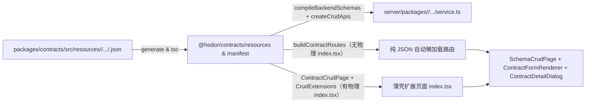

# One-Gate 全栈 JSON 契约驱动 CRUD 开发指南

本指南介绍基于顶层共享契约包 **`@hodor/contracts`**（`packages/contracts/`）的全栈 CRUD 开发方式：用**单份声明式 JSON 契约**同时驱动后端 Hono/OpenAPI 校验模型与前端 React/MUI 响应式界面（含离线 AJV 表单校验、PC 表格、移动端卡片、筛选、软删除撤销、行动作、详情弹窗与路由自动挂载）。

---

## 🏗️ 整体架构体系



### 核心职责分层

- **顶层共享契约 (`packages/contracts/`)**：
  - `schema/crud-resource.schema.json`：元 Schema 约束契约合法性。
  - `src/resources/<app>/.../<resource>.json`：唯一真源（Single Source of Truth）。按**字段为中心（Field-Centric）**声明数据类型、必填阶段（`requiredOn`）、前后端作用域成员（`in`: `list`/`detail`/`add`/`update`/`get`/`listAll`/`listFilter`）以及 UI 投影（`ui.table`/`ui.card`/`ui.filter`/`ui.form`/`ui.detail`）。
  - `src/defaults.ts`：约定优于配置推导 `app`、`route`、`basePath`、`permissionNamespace`、内置 preset（`id`/`isEnabled`/`remark`/`createTimeUtc`/`updateTimeUtc`）及标准审计字段注入。
  - `src/backend.ts`：导出 `compileBackendSchemas`，编译后端 `listReq`/`listRes`/`listAllReq`/`listAllRes`/`getReq`/`getRes`/`addReq`/`updateReq`/`deleteReq`/`deleteWithUndoReq`/`deleteWithUndoRes`/`idRes`。
  - `src/frontend.ts`：导出 `compileFrontendValidationSchema`、`projectTableColumns`、`projectCardFields`、`projectFilterConfig`、`projectFormConfig`。
  - `scripts/generate.ts` & `scripts/validate.ts`：离线编译生成 `src/generated/` 并一次性校验元 Schema、后端权限种子、OpenAPI 路径与 `zh-CN`/`en-US` 双语词条完整度。
- **后端装配层 (`server/packages/core/src/middleware/encapsulation/crud.ts`)**：
  - `createCrudApis(schemas, options)`：根据 `*BackendSchemas` 自动生成 `list`、`listAll`、`add`、`update`、`delete`、`deleteWithUndo`、`get` 等 `API` 定义，支持自定义 `adapter`、`resSchema` 及 `extra` 扩展端点。
  - `buildPagedListResult(list, total, pageNo, pageSize)`：统一分页返回包装与上限归一。
- **前端渲染层 (`platform/packages/ui/src/`)**：
  - `routes/buildContractRoutes.tsx`：结合 `@hodor/contracts/manifest` 自动挂载所有 `mountRoute: true` 的契约页面；当对应目录下存在物理 `pages/.../index.tsx` 时自动让位。
  - `components/Crud/contract/ContractCrudPage.tsx`：统一接管列表请求（`postCrudEndpoint`）、离线 AJV 表单校验、响应式表格/卡片切换、`softDelete` 乐观锁撤销及自定义 `extensions`。
  - `components/Crud/contract/ContractFormRenderer.tsx` & `ContractDetailDialog.tsx`：内置 `text`/`email`/`number`/`textarea`/`password`/`code`/`switch`/`checkbox`/`select`/`multiSelect`/`treeFlatMultiSelect`/`tagInput`/`date`/`time`/`datetime`/`dynamicSubForm`/`divider` 组件及配置化详情对话框。

---

## 🛠️ 场景一：5 分钟新增纯 JSON CRUD 页面（0 行前端 TSX）

以新建管理端配置资源 `admin/rpa/config` 为例：

### 1. 编写单份契约 JSON

新建 `packages/contracts/src/resources/admin/rpa/config.json`：

```json
{
  "$schema": "../../../../schema/crud-resource.schema.json",
  "version": 1,
  "resource": "admin/rpa/config",
  "filters": {
    "keyword": {
      "enabled": true,
      "labelKey": "filter.keyword",
      "placeholderKey": "filter.keywordLabel",
      "transform": "emptyToUndefined"
    },
    "sortableFields": ["id", "name", "isEnabled", "createTimeUtc"],
    "showSortControls": false
  },
  "fields": [
    {
      "name": "name",
      "schema": { "type": "string", "maxLength": 100 },
      "requiredOn": ["add", "list", "detail", "get"],
      "ui": {
        "labelKey": "rpa.config.name",
        "table": { "show": true },
        "card": { "role": "title" },
        "form": { "show": true, "widget": "text", "required": true, "defaultValue": "" }
      }
    },
    {
      "name": "isEnabled",
      "preset": "isEnabled"
    },
    {
      "name": "remark",
      "preset": "remark"
    }
  ]
}
```

> **约定自动推导规则**：仅填写 `"resource": "admin/rpa/config"` 时，引擎自动推导出 `app = "admin"`、`route = "rpa/config"`、`basePath = "/api/v1/admin/rpa/config"`、`permissionNamespace = "admin.rpa.config"`，并自动前置 `id` 列与 4 个审计字段（可通过 `auditFields: false`、`showIdColumn: false`、`api.endpoints` 或 `permissions` 显式覆盖）。

### 2. 后端接入 `createCrudApis`

首先运行 `pnpm --filter @hodor/contracts build` 生成 `@hodor/contracts/resources` 导出，随后在 `server/packages/admin/src/rpa/config/service.ts` 装配接口（零手写 `req`/`res` JSON Schema）：

```typescript
import type { FromSchema } from "json-schema-to-ts";
import { adminRpaConfigBackendSchemas } from "@hodor/contracts/resources";
import {
  buildPagedListResult,
  createCrudApis,
} from "@hodor/core/middleware/encapsulation/crud";
import type { UserObj } from "@hodor/core/types/app";

const S = adminRpaConfigBackendSchemas;

async function onList(params: FromSchema<typeof S.listReq>): Promise<FromSchema<typeof S.listRes>> {
  const { total, list } = await repo.findPage(params);
  return buildPagedListResult(list, total, params.pageNo ?? 1, params.pageSize ?? 10);
}

async function onAdd(params: FromSchema<typeof S.addReq>, userObj: UserObj): Promise<number | null> {
  return await repo.onInsert({ ...params, creatorId: userObj.userId });
}

export default createCrudApis(S, {
  list: onList,
  add: onAdd,
  update: onUpdate,
  delete: onDelete,
  get: onGet,
});
```

### 3. 一键全栈离线同步与校验

无需创建任何前端 `pages/` 目录、路由条目或 `api/*.ts` 包装，在**仓库根目录**执行：

```bash
pnpm run sync:all
```

该命令串联执行：`contracts:generate` → `contracts:build` → `sync:business` → `sync:permissions` → `sync:openapi` → `contracts:check`（同步校验全部契约的元 Schema、后端权限种子、`openapi.d.ts` 路径及 `zh-CN`/`en-US` 双语文案）。执行通过后即可在 `/admin/rpa/config` 直接访问完整页面。

---

## 🧩 场景二：声明内置行动作、详情弹窗与软删除撤销

许多中复杂度页面仍然**不需要**编写任何前端 TSX，仅在契约 JSON 内即可声明：

- **只读与嵌入式抽屉列表**：设置 `"readonly": true`；若页面仅作为 Drawer 内部子表（不生成独立路由），设置 `"embedded": true` 或 `"mountRoute": false`，由父抽屉通过 `<ContractCrudPage contract={...} embedded contextParams={{ appId }} />` 挂载。
- **表格内置行动作 (`actions`) & 详情弹窗 (`detailDialog`)**：
  - `type: "api"`：直接调用后端 `POST` 端点（支持 `confirmMessageKey` 二次确认、`payloadMap` 模板映射如 `{"id": "${id}"}`、`successCheck`、`refreshAfter`）。
  - `type: "detail"`：弹出 `ContractDetailDialog`，配合 `detailDialog.fetchUrl` 与 `sections`/`items` 声明式渲染 JSON/代码块、状态 Tag、告警条与时间戳。
- **软删除短时撤销 (`softDelete`)**：在契约根部声明 `softDelete: { resourceType, displayNameField, confirmMessageKey }`，后端提供 `deleteWithUndo` handler 后，`ContractCrudPage` 自动接入乐观锁并发校验与 Toast 撤销通知闭环。
- **远程下拉 (`optionsSource`) 与动态子表单 (`dynamicSubForm`)**：通过字段 `ui.form.optionsSource`（支持平面或 `parentIdField`/`childrenField` 树形扁平化）和 `ui.form.dynamicSubForm` 驱动，无需手写组件。

---

## 🎨 场景三：需要深度交互时的薄壳扩展槽 (`CrudExtensions`)

当页面必须嵌入富文本编辑器、独立抽屉、图表或 CSV 导入/导出弹窗时，在对应路由创建仅一个 `platform/apps/<app>/src/pages/<route>/index.tsx`（**禁止**再拆回 `TheFilter.tsx` / `TheTable.tsx` / `TheForm.tsx` / 孤儿 `constant.ts`），传入 `ContractCrudPage` 与 `extensions`：

```tsx
import { adminMobileAppContract } from '@hodor/contracts/resources';
import { ContractCrudPage, type CrudExtensions } from '@/components/Crud/contract';

export default function AppPage() {
  const extensions: CrudExtensions<AppRow> = {
    // 1. 顶部工具栏按钮（如导入/导出）
    toolbarActions: (helpers, translate) => <Button onClick={() => ...}>...</Button>,
    // 2. 自定义单元格 / 自定义列 / 移动端卡片
    customCells: { name: (row) => <CustomCell row={row} /> },
    // 3. 自定义表单头部/底部或局部字段接管（如富文本、多行动态键值对、时间选择）
    customFormFields: { content: (ctx) => <RichEditor ... /> },
    // 4. 打开弹窗前或提交前的异步/同步数据塑形
    afterOpen: (form, isEdit, row) => ({ ... }),
    beforeSubmitAsync: async (form, isEdit) => ({ ... }),
    // 5. 行操作按钮与挂载外部 Dialog/Drawer
    rowActions: (translate, helpers) => [{ key: 'versions', ... }],
    dialogs: (helpers) => <CustomDrawer ... />,
    // 6. 非标准接口结构适配器（如 KV 列表或 Docker Swarm 代理）
    listAdapter: async (args) => ({ data: { ok: true, data: { list, total } } }),
    mutationAdapter: { add, update, delete },
  };

  return <ContractCrudPage contract={adminMobileAppContract} extensions={extensions} />;
}
```

> **React Compiler 注意事项**：若 `customFormFields` 或 `formHeader` 内需要使用 Hooks（如 `useFormErrorContext`、`useState`、`useRef`），请将该字段渲染提取为独立命名的 React 函数组件（例如 `CronJobKeyField`、`ApiDocsUploadHeader`），切勿直接在回调内调用 Hooks。

---

## ⚡ 运行时与校验最佳实践

1. **客户端校验完全离线运行**：`ContractCrudPage` 通过 `compileFrontendValidationSchema(contract, 'add' | 'update')` 在构建期直接获得标准 Draft JSON Schema，不再依赖运行时请求服务端 D1 同步校验模型。
2. **契约字段必填与展示分离**：使用 `in` 控制字段是否进入某类接口体，`requiredOn` 控制后端 JSON Schema 的 `required` 数组（其中 `'get'` 控制 `listAllRes` 单项必填；`'list'` 控制分页响应单项必填；`'detail'` 控制 `/get` 响应必填；`'add'` / `'update'` 控制写入校验）。
3. **文本截断与代码块规范**：表格截断统一使用 `"renderer": "text", "truncate": 50`（可选 `"tooltip": true` / `"stripHtml": true`）；表单多行代码统一使用 `"widget": "code", "theme": "dark"`；卡片标签统一使用 `"labelKey"` 声明国际化键值。
4. **严格类型与异常处理**：契约与扩展代码严禁出现 `any` / `as any`；前端请求异常由 `@/api/config` 全局拦截器统一处理，扩展 `catch` 块保留简短注释即可，禁止调用 `console.error` 或重复弹窗。
